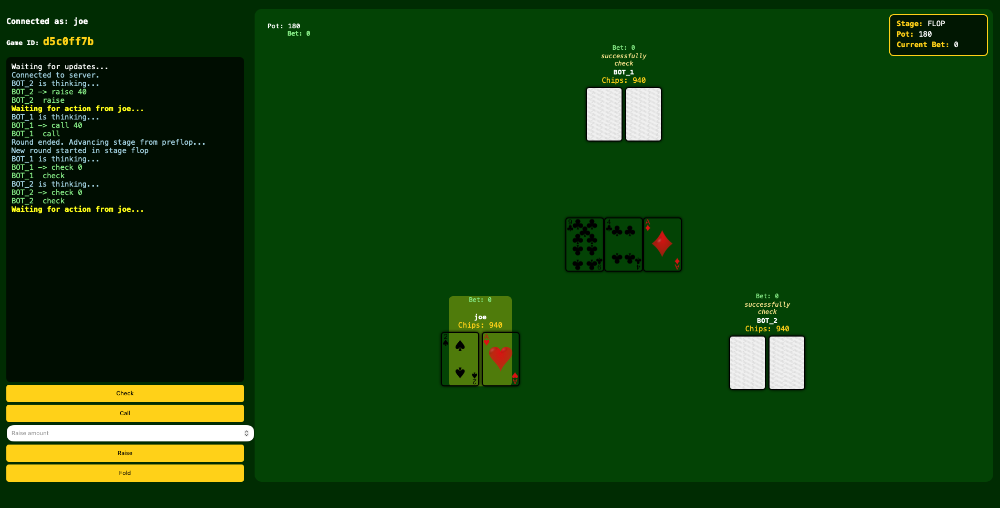
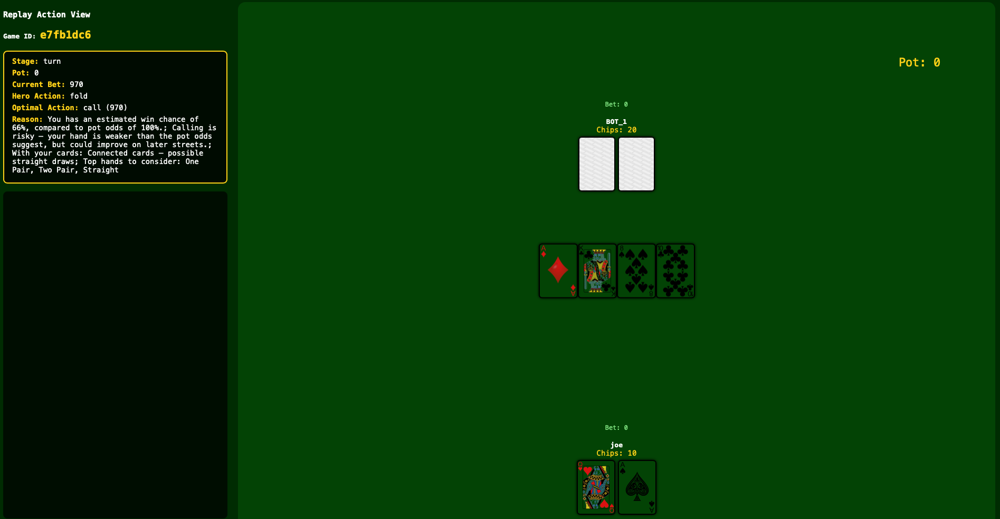

# Poker Trainer

A full-stack poker training application built with **Python, FastAPI and WebSockets**, featuring real-time multiplayer gameplay, AI opponents, machine-learning-based decision-making, player statistics and hand replay analysis.

Originally developed as a Computer Science project, Poker Trainer combines game-engine development, asynchronous networking, database management and machine learning in a single application.

## Features

- **Real-time poker gameplay:** WebSocket-based communication between players and the server, with betting rounds, turn management, hand evaluation and pot distribution.
- **AI opponents:** Poker bots with decision-making strategies that incorporate hand strength, estimated equity, pot odds and machine learning.
- **Machine learning:** Scikit-learn models for predicting poker actions and bet sizes, with a fallback mechanism for generating models when trained files are unavailable.
- **Player analytics:** Tracking of poker statistics, including VPIP, PFR and aggression-related metrics.
- **Hand replay system:** Persistent hand histories and action-by-action replay functionality for reviewing previous games.
- **User authentication:** Account registration, login and JWT-based authentication, with password hashing and access-controlled replay endpoints.

## Tech Stack

| Component | Technologies |
|---|---|
| Backend | Python, FastAPI |
| Real-time communication | WebSockets, asynchronous Python |
| Database | SQLite, SQLAlchemy |
| Machine learning | Scikit-learn, NumPy, Joblib |
| Authentication | JWT, Passlib, bcrypt |
| Frontend | HTML, CSS, JavaScript, Jinja2 |

## Architecture

The application is divided into several components:

- `auth/` — User authentication, database models, JWT handling and account-related endpoints.
- `game_clean/poker/` — Core poker engine, including deck management, betting, hand evaluation, pots, players and AI opponents.
- `game_clean/managers/` — Game-table lifecycle, WebSocket connections, player profiles, database operations and replay management.
- `game_clean/ml/` — Feature extraction, model training, action prediction and bet-size prediction.
- `game_clean/database/` — Game database configuration and persistence.
- `templates/` and `static/` — Frontend pages, styling and card assets.
- `login_main.py` — FastAPI application entry point and route integration.

### Game flow

1. A user authenticates and creates or joins a poker table.
2. The table manager initialises the game and coordinates player connections.
3. The poker engine manages betting, cards, turns and hand evaluation.
4. AI opponents evaluate the game state and select actions.
5. Game updates are transmitted through WebSockets.
6. Recorded actions can be reviewed through the replay and analysis features.

## Installation

### Requirements

- Python 3.12
- Git

### 1. Clone the repository

```bash
git clone https://github.com/V1shalY0ges/Poker-Trainer.git
cd Poker-Trainer
```

### 2. Create a virtual environment

```bash
python3 -m venv .venv
source .venv/bin/activate
```

On Windows:

```powershell
.venv\Scripts\activate
```

### 3. Install dependencies

```bash
pip install -r requirements.txt
```

### 4. Configure environment variables

Copy the example environment file:

```bash
cp .env.example .env
```

Edit `.env` and configure the required settings:

```dotenv
FRONTEND_URL=http://127.0.0.1:3000
SECRET_KEY=replace_with_a_random_secret
EMAIL_ADDRESS=your_email@gmail.com
EMAIL_PASSWORD=your_email_app_password
```

Generate a secure JWT secret using:

```bash
python -c "import secrets; print(secrets.token_urlsafe(48))"
```

Email credentials are required for features that send email; use appropriate application credentials rather than your main email password.

### 5. Run the application

```bash
python -m uvicorn login_main:app --reload --port 3000 --no-access-log --log-level warning
```

Open `http://127.0.0.1:3000` in your browser.

SQLite database files are created locally and are excluded from version control. Machine-learning models can also be generated locally if previously trained models are unavailable.

## Screenshots

### Real-Time Poker Gameplay



### Hand Replay




## Technical Highlights

**Asynchronous multiplayer networking:** Uses WebSockets to maintain real-time communication between connected clients and the game server.

**Poker game engine:** Implements game-state transitions, player actions, betting rules, hand evaluation and pot management.

**Machine-learning integration:** Incorporates trained models into bot decision-making, including action classification and bet-size prediction.

**Persistent game analysis:** Records player actions and game histories to support statistical analysis and hand replay.

**Authentication and authorization:** Uses signed JWTs for authentication and restricts access to users' replay histories.

## Project Status

This is a portfolio version of an earlier Computer Science project. It is intended primarily as a demonstration of backend development, game logic, networking and applied machine learning.

The application is designed for local development and demonstration, rather than production deployment.